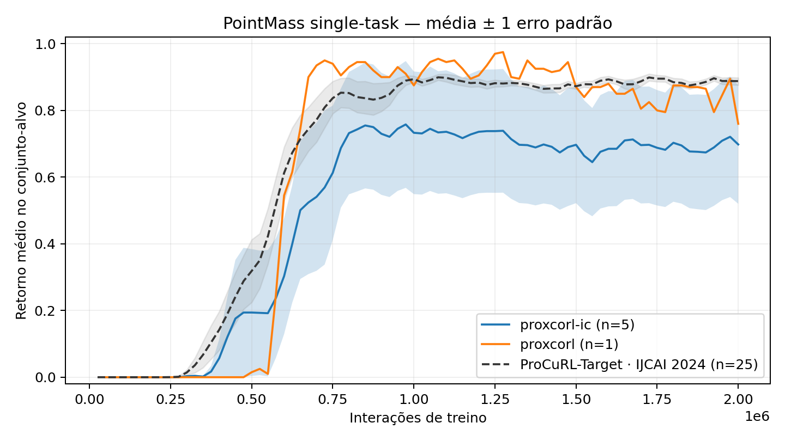
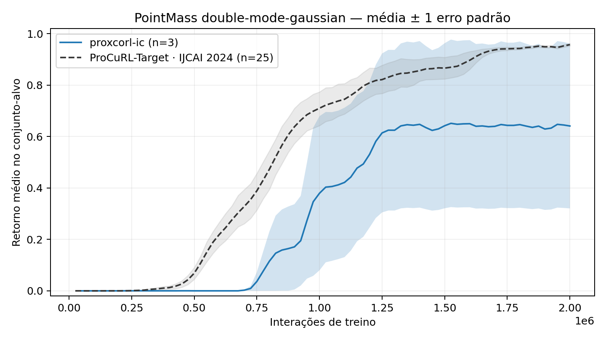

# Comparação com a Figura 2 do ProCuRL-Target

Executamos oito treinos completos da implementação da IC e um controle completo com o professor dos autores. Foram cinco sementes (0–4) em PM-S:1T e três (0–2) em PM-S:2G. O controle usou a semente 0 em PM-S:1T. Cada treino completou 2.001.920 interações, com 80 avaliações periódicas. O artigo agrega 25 sementes por cenário. Esse tamanho amostral diferente limita conclusões de equivalência e divergência.

## Retorno no mesmo passo de treinamento

Como a recompensa final é 0 ou 1, 80% significa sucesso em cerca de oito de cada dez episódios. Os valores da tabela são médias de duas avaliações consecutivas por semente, seguidas de média entre sementes. A incerteza da IC é um erro padrão entre sementes. Os resultados do artigo são leituras da Figura 2 arredondadas. A tabela de cada cenário inclui os limites da faixa publicada.

| Cenário | Passos | IC, média ± EP | Artigo, média | IC menos artigo |
|---|---:|---:|---:|---:|
| PM-S:1T | 500 mil | 19,4% ± 19,0 p.p. | 31,9% | -12,5 p.p. |
| PM-S:1T | 1 milhão | 73,3% ± 18,4 p.p. | 89,4% | -16,1 p.p. |
| PM-S:1T | 2 milhões | 69,8% ± 17,8 p.p. | 88,8% | -19,0 p.p. |
| PM-S:2G | 500 mil | 0,0% ± 0,0 p.p. | 6,9% | -6,9 p.p. |
| PM-S:2G | 1 milhão | 38,0% ± 30,0 p.p. | 71,0% | -33,1 p.p. |
| PM-S:2G | 2 milhões | 64,1% ± 32,1 p.p. | 95,8% | -31,6 p.p. |

- Em **PM-S:1T**, a média da IC atingiu 50% pela primeira vez em **650 mil** passos. Na figura dos autores, o primeiro ponto comum acima desse limiar foi em **575 mil** passos.
- Em **PM-S:2G**, a média da IC atingiu 50% pela primeira vez em **1,2 milhão** passos. Na figura dos autores, o primeiro ponto comum acima desse limiar foi em **825 mil** passos.
- Em **PM-S:1T**, a semente 1 obteve zero sucessos nas 80 avaliações periódicas. As outras quatro terminaram entre 76,0% e 96,5% na última janela, com média de 87,25% entre elas. O resultado principal de 69,8% inclui as cinco sementes.
- Em **PM-S:2G**, as sementes 0 e 1 terminaram em 97,05% e 95,30%. A semente 2 terminou em 0%. A média das três foi 64,12%.

### PM-S:1T



### PM-S:2G



## Variação entre execuções

A coluna dos 2 milhões usa a janela de duas avaliações que entra na comparação. A última coluna usa o checkpoint final depois da última atualização PPO e uma nova semente de avaliação. O primeiro ponto em que o agente atinge 50% indica velocidade de aprendizagem e pode ser seguido de queda.

| Cenário | Professor | Semente | Primeira janela ≥50% | Na curva aos 2 milhões | Avaliação adicional final |
|---|---|---:|---:|---:|---:|
| PM-S:1T | proxcorl | 0 | 600 mil | 76,0% | 90,0% |
| PM-S:1T | proxcorl-ic | 0 | 600 mil | 76,0% | 90,0% |
| PM-S:1T | proxcorl-ic | 1 | Não atingiu | 0,0% | 0,0% |
| PM-S:1T | proxcorl-ic | 2 | 650 mil | 92,0% | 93,0% |
| PM-S:1T | proxcorl-ic | 3 | 775 mil | 84,5% | 73,0% |
| PM-S:1T | proxcorl-ic | 4 | 425 mil | 96,5% | 91,0% |
| PM-S:2G | proxcorl-ic | 0 | 1,2 milhão | 97,0% | 93,0% |
| PM-S:2G | proxcorl-ic | 1 | 900 mil | 95,3% | 95,8% |
| PM-S:2G | proxcorl-ic | 2 | Não atingiu | 0,0% | 0,0% |

## Controle de implementação

Na semente 0 em PM-S:1T, o professor dos autores atingiu **76,0%** na última janela. A diferença do professor da IC para o dos autores nessa mesma semente foi **0,0 p.p.** A matriz completa dos retornos por avaliação e episódio foi idêntica entre as duas execuções.

Congelamos o mesmo checkpoint (modelo final da IC, PM-S:2G, semente 0), fixamos as amostras-alvo e comparamos as probabilidades atribuídas às 20.000 tarefas pelos dois professores. A maior distância de variação total entre as duas distribuições, considerando os dois cenários, foi **1.41e-07**. A variação total é metade da soma das diferenças absolutas de probabilidade e vale zero para distribuições idênticas. Os detalhes numéricos estão em [parity.json](parity.json). A suíte passou nos 12 testes automatizados. Na comparação pareada em PM-S:1T, os 8.000 retornos e os comprimentos dos episódios foram idênticos nas 80 avaliações. A coincidência dos retornos e das durações nessa semente e o resultado numérico com o crítico congelado sustentam a fidelidade de implementação nos casos testados. A variação entre as sementes limita a conclusão sobre as médias publicadas.

Outras duas execuções preliminares de 102.400 passos serviram para validar a instalação e a avaliação em 1T e 2G. Elas estão excluídas das médias desta página.

## Dados e reprodução

- [Tabela completa PM-S:1T](pointmass/single-task-proxcorl-ic-vs-paper.csv) · [Controle dos autores, semente 0](pointmass/single-task-proxcorl-vs-paper.csv)
- [Tabela completa PM-S:2G](pointmass/double-mode-gaussian-proxcorl-ic-vs-paper.csv) · [Fonte e extração da curva publicada](../reference/README.md)
- [Diferenças de implementação e motivos](../docs/DIFERENCAS.md) · [Código exato usado para o treino](https://github.com/mcra3287/procurl-ic/tree/1a8abfe073a2ce0b6392295d32c0a8795ecc980e)

Os arquivos abaixo contêm, por execução, o checkpoint final, os retornos e comprimentos de episódio em cada avaliação, a configuração efetiva e o resultado da avaliação adicional final. Os metadados preservam o identificador local `b27578b4c6b5a717e069b290a658874a2bbde446`. Conferimos que o commit publicado `1a8abfe073a2ce0b6392295d32c0a8795ecc980e` e o commit local possuem a mesma árvore Git `1ed92809f18b1a655bb2f2e63b37f65810fd262f`.

| Dados | SHA-256 |
|---|---|
| [PM-S:1T](pointmass/single-task.zip) | `a82b4533cabb28cd3ec26ee26b55aa430c5076a4a75fc8011848e6c4953925b2` |
| [PM-S:2G](pointmass/double-mode-gaussian.zip) | `4ffa1987311ecbc5c58f699c565a56a362c66fb6a76c0846052f9e0546cc19b9` |

Para conferir os números a partir dos arquivos versionados, execute da raiz de um clone completo:

```bash
mkdir -p results/medidos
unzip -n reports/pointmass/single-task.zip -d results/medidos
unzip -n reports/pointmass/double-mode-gaussian.zip -d results/medidos
.venv/bin/python run_pointmass_suite.py aggregate --output results/medidos --curricula proxcorl-ic proxcorl
.venv/bin/python check_pointmass_parity.py results/medidos/double-mode-gaussian/proxcorl-ic/seed-0/final_model.zip --output results/parity.json
```

Para repetir os treinos do zero e comparar com os artefatos versionados, escolha uma pasta de saída nova:

```bash
.venv/bin/python run_pointmass_suite.py run --output results/repeticao --targets single-task --curricula proxcorl-ic --seeds 0 1 2 3 4 --workers 2
.venv/bin/python run_pointmass_suite.py run --output results/repeticao --targets double-mode-gaussian --curricula proxcorl-ic --seeds 0 1 2 --workers 2
.venv/bin/python run_pointmass_suite.py run --output results/repeticao --targets single-task --curricula proxcorl --seeds 0
```

Hardware e bibliotecas podem alterar trajetórias numéricas. Os hashes de dados, as versões de Python/PyTorch/SB3 e as sementes estão nos arquivos de configuração. O relatório compara as condições de PointMass; os demais ambientes e a bateria completa dos concorrentes do artigo exigem outros experimentos.
